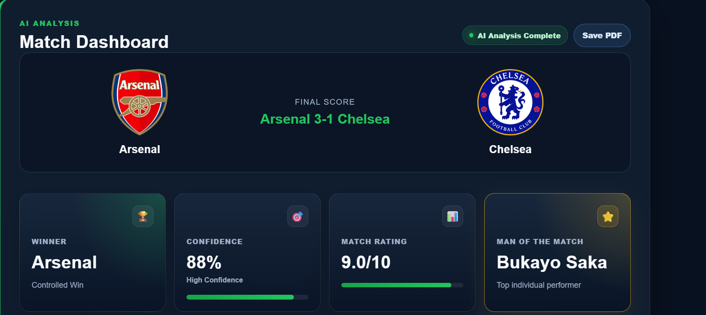
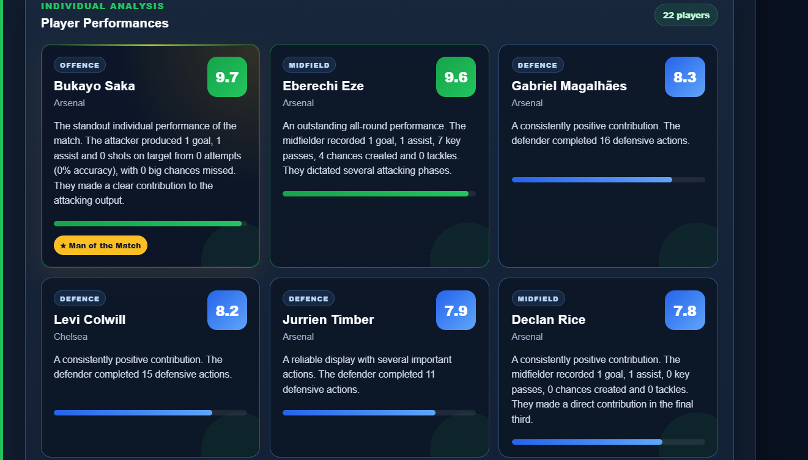
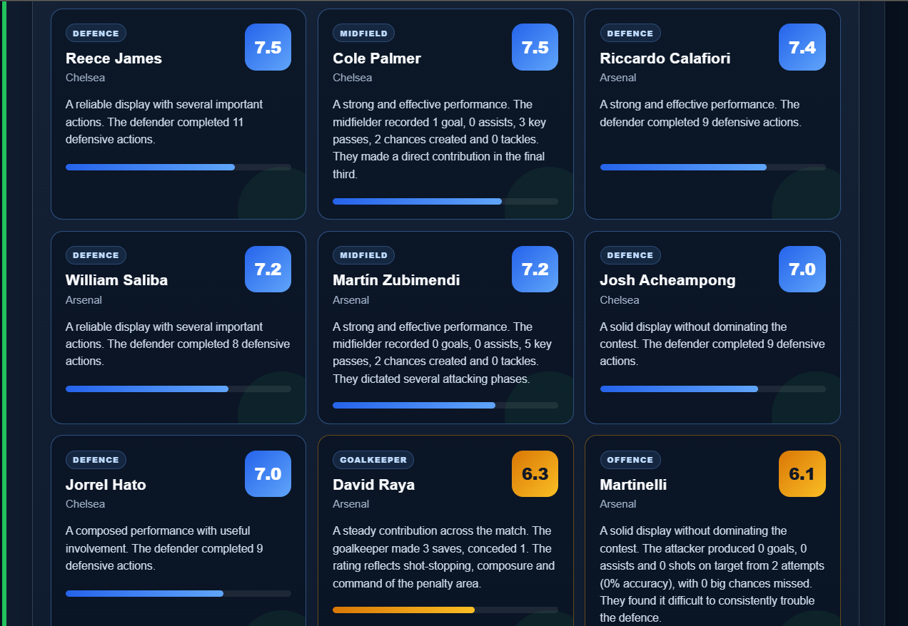
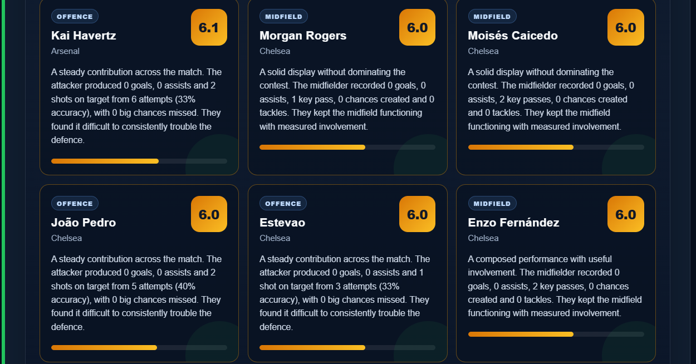
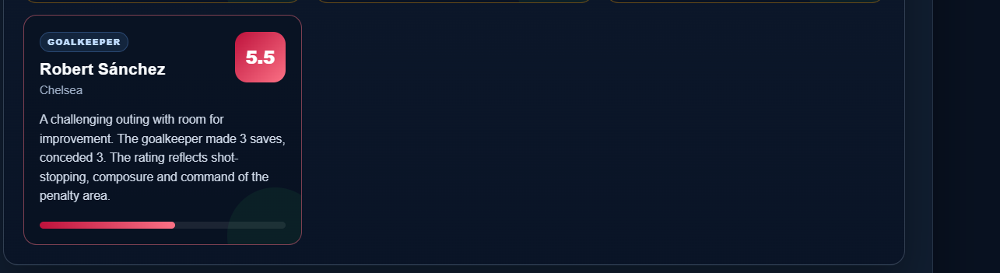
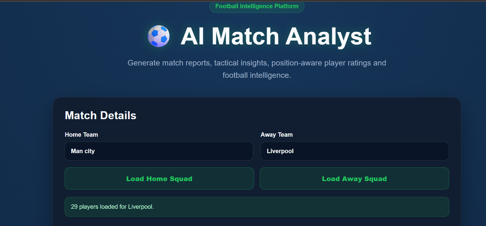
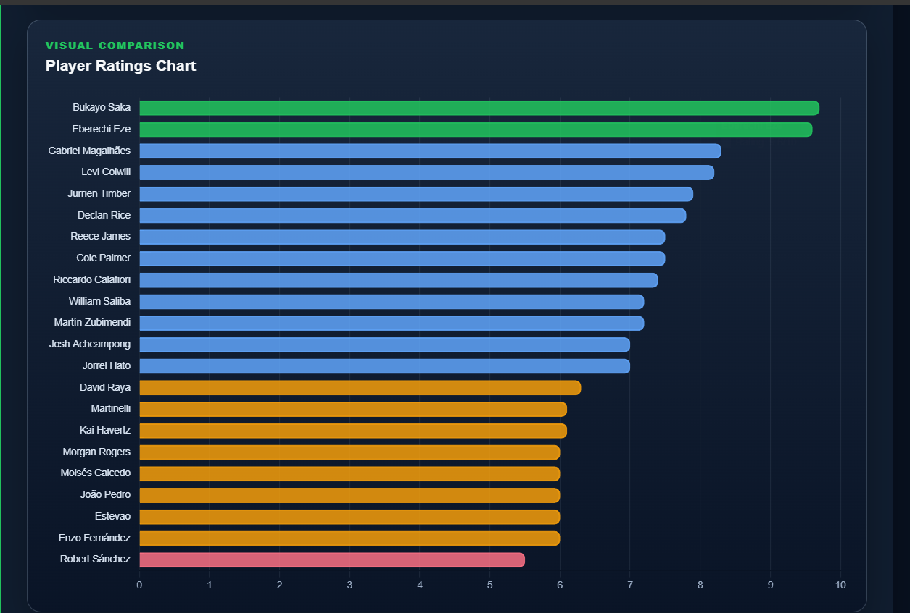

⚽ AI Match Analyst

Full-stack football analytics and post-match intelligence platform

Transforms match data and player statistics into structured match analysis, position-aware player ratings, tactical insights, interactive visualisations, saved match history, and print-ready reports.

Overview

AI Match Analyst is a full-stack football analytics web application that turns match information into a polished post-match dashboard.

Users can load team squads, select the players who appeared, enter position-specific performance statistics, and generate an analytical report containing match intelligence, player ratings, tactical observations, key moments, team comparisons, and a final verdict.

The project combines a FastAPI + SQLite backend with a responsive HTML, CSS, and JavaScript frontend. External football services are used for squad data and club badges, while the application's own analysis and rating engine converts the submitted match data into structured football insights.

Important: the current analysis engine is deterministic and rule-based rather than an external LLM or machine-learning model. The "AI Match Analyst" branding refers to the intelligent analytical experience and structured decision logic implemented by the application.

## Screenshots

### Match Dashboard

The generated dashboard presents the final score, winner, confidence, match rating, Man of the Match, team comparison, tactical analysis and match intelligence in one interface.

### Position-Aware Player Ratings

Player performances are evaluated using statistics relevant to each position, with individual summaries, visual rating bars and Man of the Match highlighting.

### Analysis Loading Experience

A staged loading interface provides visual feedback while the backend calculates player ratings, tactical insights and the final report.

### PDF Export

Completed reports can be formatted for A4 and exported using the browser's native PDF/print system.

---

Key Features

Match analysis

Generates a structured post-match report from the final score, possession, shots, goalscorers, key moments, and player data.

Detects the winner, draw state, clean sheets, goal difference, and overall match type.

Produces an entertainment Match Rating and a result Confidence assessment.

Generates a match summary, tactical analysis, key turning points, match intelligence indicators, and final verdict.

Position-aware player ratings

Every selected player starts from a baseline rating and is evaluated using statistics relevant to their role.

Position

Examples of rating inputs

Goalkeeper

Saves, penalty saves, clean sheet, goals conceded

Defence

Tackles, interceptions, clearances, goals, assists, defensive errors, clean sheet

Midfield

Goals, assists, key passes, chances created, tackles

Offence

Goals, assists, shots, shots on target, big chances missed

The engine also generates a position-specific performance summary for each player instead of applying one generic description to the entire squad.

Squad integration

Loads football squad data through the backend using football-data.org.

Supports separate home and away squad selection.

Automatically carries player name, team, position, and nationality into the analysis workflow.

Populates the Man of the Match selector from the players selected for the match.

The current frontend requests the Premier League (PL) competition by default.

Match dashboard

The generated dashboard includes:

Final score and team badges

Winner

Confidence percentage and label

Match rating

Man of the Match

Team-stat comparison bars

Match summary

Tactical analysis

Key turning points

Match intelligence indicators

Final verdict

Individual player performance cards

Position badges and rating bars

Highlighted Man of the Match card

Interactive player-rating chart

Visualisation and UX

Responsive dark football-analytics interface

Staged analysis loading screen

Animated progress indicators

Animated team comparison bars

Sequential dashboard reveals

Chart.js horizontal player-rating visualisation

Graceful fallback when a team badge cannot be loaded

Reduced-motion support

Mobile-friendly layout

Match history

Generated reports are stored locally using SQLite and can be revisited from the Match History section.

Saved data includes:

Teams

Final score

Winner

Match type

Match rating

Creation time

Generated report

PDF / print export

The finished dashboard can be exported through the browser's native print system.

For the best result:

Click Save PDF.

Choose Save to PDF or Microsoft Print to PDF as the destination.

Use A4 paper size.

Enable Background graphics to preserve the dashboard styling.

Technology Stack

Backend

Technology

Purpose

Python

Core backend and analysis logic

FastAPI

REST API

Pydantic

Request validation and data models

SQLite

Local match-history persistence

Requests

External football API calls

python-dotenv

Environment-variable loading

Frontend

Technology

Purpose

HTML5

Application structure

CSS3

Responsive dashboard design and animations

JavaScript

UI state, API calls, rendering, squad selection, history, export

Chart.js

Player-rating visualisation

External data services

Service

Use

football-data.org

Team and squad data

TheSportsDB

Club badge lookup

Architecture

flowchart LR
    U[User] --> F[HTML / CSS / JavaScript Frontend]

    F -->|Load squad| API[FastAPI Backend]
    F -->|Generate report| API
    F -->|Load history| API
    F -->|Team badge request| API

    API --> FD[football-data.org]
    API --> TS[TheSportsDB]
    API --> E[Match Analysis Engine]
    API --> R[Position-Aware Rating Engine]

    E --> DB[(SQLite)]
    R --> E

    API -->|Structured report data| F
    F --> C[Chart.js Visualisation]
    F --> P[Browser PDF / Print Export]

Project Structure

AI-Match-Analyst/
│
├── backend/
│   ├── main.py
│   ├── .env                 # local only, ignored by Git
│   └── match_history.db     # created locally, ignored by Git
│
├── frontend/
│   ├── index.html
│   ├── script.js
│   └── style.css
│
├── .gitignore
├── LICENSE
├── README.md
└── requirements.txt

API Endpoints

Method

Endpoint

Description

GET

/

Backend health/configuration response

GET

/team-logo/{team_name}

Retrieves a club badge

POST

/load-squad

Loads squad data for a team

POST

/generate-report

Analyses the submitted match and generates the report

GET

/history

Returns saved match reports

FastAPI also provides interactive API documentation while the backend is running:

http://127.0.0.1:8000/docs

Getting Started

Prerequisites

Python 3.10+

pip

A modern browser

A football-data.org API key

1. Clone the repository

git clone https://github.com/MustafaH28/AI-Match-Analyst.git
cd AI-Match-Analyst

2. Create a virtual environment

Windows PowerShell

python -m venv .venv
.\.venv\Scripts\Activate.ps1

macOS / Linux

python3 -m venv .venv
source .venv/bin/activate

3. Install dependencies

pip install -r requirements.txt

Environment Variables

Create:

backend/.env

Add:

FOOTBALL_DATA_API_KEY=your_api_key_here

The .env file is intentionally excluded from Git and should never be committed.

Running the Application

Start the backend

cd backend
uvicorn main:app --reload

Backend:

http://127.0.0.1:8000

Start the frontend

Open a second terminal:

cd frontend
python -m http.server 5500

Then open:

http://127.0.0.1:5500

The frontend currently communicates with:

http://127.0.0.1:8000

through API_BASE_URL in frontend/script.js.

Typical Workflow

Enter the Home Team and Away Team.

Load each squad.

Select the players who appeared in the match.

Enter position-specific statistics for those players.

Add the final score, goalscorers, possession, shots, Man of the Match, and key moments.

Click Generate Report.

Review the dashboard, tactical analysis, intelligence indicators, player cards, and ratings chart.

Reopen saved reports from Match History.

Use Save PDF to export the dashboard.

How the Analysis Engine Works

The backend converts submitted match data into structured football intelligence:

Parses the final score and determines the result.

Compares goal difference, shot difference, and possession.

Detects clean-sheet and draw scenarios.

Assigns a match type, entertainment rating, and confidence category.

Calculates each player's rating using position-specific statistics.

Generates player summaries based on their actual contributions.

Builds the match summary, tactical reading, turning points, indicators, and verdict.

Stores the generated report in SQLite.

Returns structured data to the frontend for dashboard rendering.

The deterministic design keeps the current version explainable and consistent: the same input produces the same analytical result.

Player Rating Philosophy

Player ratings use a 6.0 baseline and apply positive and negative adjustments based on performance.

Examples:

Goalkeepers: saves, penalty saves, clean sheets, goals conceded

Defenders: tackles, interceptions, clearances, attacking contributions, clean sheets, defensive mistakes

Midfielders: goals, assists, key passes, chance creation, defensive work

Attackers: goals, assists, shooting output, shots on target, missed big chances

Ratings are displayed as individual cards and compared in the Chart.js ratings graph.

Data and Security

Local or sensitive application data is excluded from version control.

Examples:

backend/.env
*.db
*.sqlite
*.sqlite3
__pycache__/
*.pyc

This keeps API credentials and local match history out of the public repository.

Current Limitations

The analysis engine is rule-based and deterministic, not an LLM or trained machine-learning model.

Player performance statistics are entered by the user after squad selection rather than retrieved from a live event feed.

Squad loading currently requests the Premier League competition by default.

External squad and badge data depend on third-party API availability and plan limits.

SQLite history is local to the backend instance.

The application does not currently include user accounts or cloud-synchronised report history.

The frontend currently expects the backend at 127.0.0.1:8000 unless API_BASE_URL is changed.

Future Development

Potential future versions could add:

Multi-league and multi-competition squad loading

Automatic completed-match lookup

Live match-event ingestion

Expected goals (xG) and advanced metrics

Formation and passing-network visualisations

Persistent cloud database storage

User accounts and saved profiles

Optional LLM-generated tactical commentary

Machine-learning match prediction

Public deployment with environment-specific API configuration

Automated testing and CI/CD

What This Project Demonstrates

REST API design

Python backend development

Frontend JavaScript and DOM manipulation

Asynchronous API communication

External API integration

JSON data handling

Input validation

Position-aware scoring algorithms

SQLite persistence

Responsive UI design

Data visualisation

Error handling and fallback states

Environment-variable management

Git and GitHub workflow

Print/PDF-friendly report generation

Version

v1.0

Core functionality is complete, including squad retrieval, match analysis, position-aware player ratings, dashboard visualisation, local history, and PDF/print export.

Author

Mustafa Hassan

GitHub: @MustafaH28

License

This project is licensed under the MIT License.

See LICENSE for details.

Built as a full-stack football analytics project with Python, FastAPI, JavaScript, SQLite, and live football data integrations.
